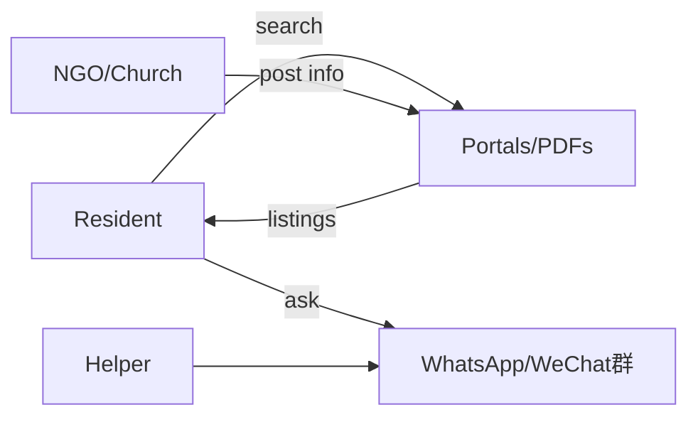
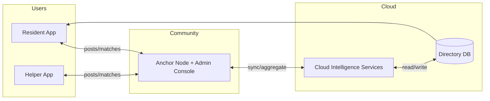
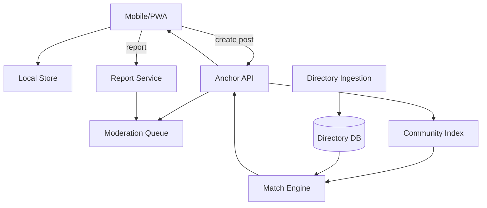

# WeaveNYC — Blueprints (Conceptual / Logical / Physical)

> 目的：用“蓝图”把大图说清楚，让所有人对系统边界、组件关系、部署形态达成一致。

本文件包含：
1) As-Is（当前世界：用户怎么找资源）
2) To-Be（WeaveNYC 未来态）
3) Transition（从 As-Is 到 To-Be 的迁移路径）

> **独立图表文件**：所有蓝图的 Mermaid 源文件已提取到 [`../diagrams/`](../diagrams/) 文件夹，可在 GitHub / VS Code / mermaid.live 中直接渲染查看。详见 [`diagrams/README.md`](../diagrams/README.md)。

每一部分都给出：
- Conceptual Blueprint（概念层：业务参与者 + 关键能力）
- Logical Blueprint（逻辑层：服务/数据流，不绑定具体云厂商）
- Physical Blueprint（物理层：落到具体云/PaaS/部署拓扑）

---

## 0) Legend（所有蓝图通用）
- Domain：Application + Data + Technical
- Scope：System(Project)
- Level：Conceptual / Logical / Physical
- State：As-Is / To-Be / Transition

---

## 1) As-Is（现状）

### 1.1 Conceptual (As-Is)
参与者：
- Resident（求助者）
- Helper（志愿者）
- NGO/Church（组织）
- City/State Portals（政府目录）

现状能力：
- 信息搜寻分散（多个网站、PDF、地图工具）
- 互助依赖私域群（WhatsApp/WeChat）
- 缺乏验证与安全治理



### 1.2 Logical (As-Is)
- 数据源：PDF、网页、口头信息
- 交互：电话/现场排队/群消息
- 治理：弱/无（群管理员个人经验）

### 1.3 Physical (As-Is)
- 用户手机 + 社交软件 + 政府网站
- 无专用后端、无统一日志、无统一审核

---

## 2) To-Be（WeaveNYC）

### 2.1 Conceptual (To-Be)
核心能力（MVP）：
1) 统一资源目录（官方资源 + 社区资源）
2) 互助发布与匹配（Offer/Request）
3) 社区自治治理（Anchor 审核/公告/规则）
4) 隐私优先（默认本地、最小上传）

参与者：
- Residents（含多语言群体）
- Helpers
- Anchors（社区组织）
- Cloud Services（用于重计算/搜索/通知）



### 2.2 Logical (To-Be)
> 不绑定具体云厂商，只描述服务与数据流。
> 当前 `main` 已经把这部分收口为 **HTTP-first + P2P sync overlay**；下面保留的 libp2p / full-node 拓扑属于更激进的未来蓝图，不是当前 canonical runtime 真值。

**服务分层**
- Client Layer
  - Mobile/PWA UI（Next.js + React + TypeScript）
  - Local Store（IndexedDB via Dexie.js）
  - State（Redux Toolkit + TanStack Query）
  - Voice-to-text（三层降级：端侧 → Web Speech → Cloud Gateway）
  - P2P Client（libp2p-js + Helia，WebWorker 运行）

- Node Layer（P2P/社区层）
  - Edge Node：本地发布/搜索/缓存 + GossipSub 订阅
  - Anchor Node：索引、规则引擎、审核、公告、限流 + IPFS Pin + GossipSub Relay

- Cloud Layer（6 个微服务，Fastify + TypeScript）
  - API Gateway：路由/鉴权/限流
  - Resource Directory：官方目录导入/版本控制/地理查询（PostGIS）
  - Posts Service：帖子 CRUD + P2P 索引同步
  - Match Engine：候选生成 + 排序
  - Chat Service：WebSocket 中继 + 消息存储
  - Notification Service：Push/SMS/Email

- Data Layer
  - PostgreSQL + PostGIS：中心索引（资源/帖子/用户/社区/审核）
  - IPFS (Helia)：内容寻址存储（帖子摘要 DAG）
  - Redis：会话/限流/Pub-Sub/任务队列（BullMQ）
  - S3/GCS/Azure Blob：备份/快照

**关键数据对象**
- OfficialResource
- MutualAidPost（Offer/Request）
- MatchSuggestion
- Conversation
- Report/ModerationAction
- Community + Rules



### 2.3 Physical (To-Be)
> 物理层把”逻辑服务”落到具体部署拓扑。详见 [07_P2P_Node_Design](./07_P2P_Node_Design.md) 和 [ADR-0004](./15_ADR_Log.md)。
> 当前 branch 真实落地仍是：`api-gateway` 内嵌单个 Anchor sync runtime + browser worker 通过 bootstrap / websocket / HTTP catch-up 接入；下面的 full-node / relay 蓝图不应被当成当前实现。

**节点类别（3 类）**

| 节点 | 运行环境 | P2P 角色 | 存储 |
|------|----------|----------|------|
| **Edge** | 用户手机/PWA（浏览器） | libp2p-js (WebWorker) + Helia | IndexedDB (Dexie.js) |
| **Anchor** | 社区组织服务器/VPS | libp2p Node.js 完整节点（GossipSub Relay + IPFS Pin） | SQLite/PostgreSQL + IPFS |
| **Cloud** | 跨云 PaaS | libp2p 中继节点（备份） | PostgreSQL + PostGIS + Redis + S3 |

**跨云落位（满足课程 3 云 3 PaaS 要求）**

| 云 | 服务 | 部署方式 | 用途 |
|----|------|----------|------|
| **AWS** | Lambda + ECS Fargate + RDS (PostgreSQL) + S3 | Serverless/容器 + 托管 DB | API Gateway + Match Engine + Posts + Chat(Fargate) + 目录存储 + 备份 |
| **GCP** | Cloud Run + Cloud Storage | 容器化 | Resource Directory Ingestion/Parser |
| **Azure** | Functions + Azure Blob | Serverless | Notification Service + Speech Gateway |
| **Vercel** | Edge Network | CDN + SSR | PWA 前端 + Anchor Admin Console |

**P2P 网络拓扑**

```
Edge (WebRTC) <──> Edge           # 浏览器间直连
Edge (WebSocket) <──> Anchor      # Edge 连接 Anchor 中继
Anchor (TCP) <──> Cloud Relay     # Anchor 与 Cloud 中继节点
Cloud Relay (TCP) <──> Anchor     # 跨社区消息中继
```

```mermaid
flowchart LR
  subgraph Edge[“Edge (PWA + libp2p WebWorker)”]
    U1[User PWA\n+ IndexedDB\n+ Helia Client]
    U2[User PWA\n+ IndexedDB\n+ Helia Client]
  end

  subgraph Anchor[“Anchor (libp2p Full Node + IPFS Pin)”]
    AN[Anchor Node\n(Fastify API + GossipSub Relay\n+ Helia Pin + Rules Engine)]
    AC[Anchor Admin Console\n(Next.js)]
  end

  subgraph AWS
    L1[AWS Lambda\nMatch Engine]
    RDS[(RDS PostgreSQL\n+ PostGIS)]
    S3[(S3\nSnapshots/Backups)]
  end

  subgraph GCP
    CR[GCP Cloud Run\nResource Ingestion]
    GCS[(Cloud Storage)]
  end

  subgraph Azure
    AF[Azure Functions\nNotification + Speech]
    AB[(Azure Blob)]
  end

  subgraph Shared[“Shared Infra”]
    RD[Redis\n(ElastiCache/Upstash)]
  end

  U1 <-->|”WebRTC\n(P2P direct)”| U2
  U1 <-->|”WebSocket\n(GossipSub)”| AN
  U2 <-->|”WebSocket\n(GossipSub)”| AN
  AC <-->|HTTPS| AN

  AN <-->|”REST API”| L1
  L1 <--> RDS
  L1 --> S3
  CR --> GCS
  CR --> RDS
  L1 --> AF
  L1 <--> RD
  AN <--> RD
```

---

## 3) Transition（分阶段演进）

### 3.1 Transition 0：MVP（最快上线）
- 官方目录导入 + ZIP 搜索
- 发帖/匹配/聊天
- Anchor 最小后台（审核/公告）
- 只做“近似位置”与“社区可见”

### 3.2 Transition 1：P2P 同步（增强隐私与自治）
- 当前 branch 只做 HTTP-first 的 P2P sync overlay：bootstrap、live websocket、offline catch-up
- `mDNS` 仍然只是 demo-only 标志，不是默认 discovery 路径
- 完整 libp2p / Helia 内容网络保留为未来探索，不属于当前 M6 运行面

### 3.3 Transition 2：弹性与多社区扩展
- 多 Anchor 多社区
- Match/Risk 拆分为独立服务
- 灰度发布与更细粒度的规则配置

---

## 4) 蓝图验收清单（Review Checklist）
- 是否明确：参与者、边界、输入输出？
- 是否明确：MVP 服务最小集合？
- 是否明确：哪些数据“默认本地”，哪些可以 opt-in 同步？
- 是否明确：哪些动作需要 Anchor 审核？
- 是否明确：官方资源永远兜底？
